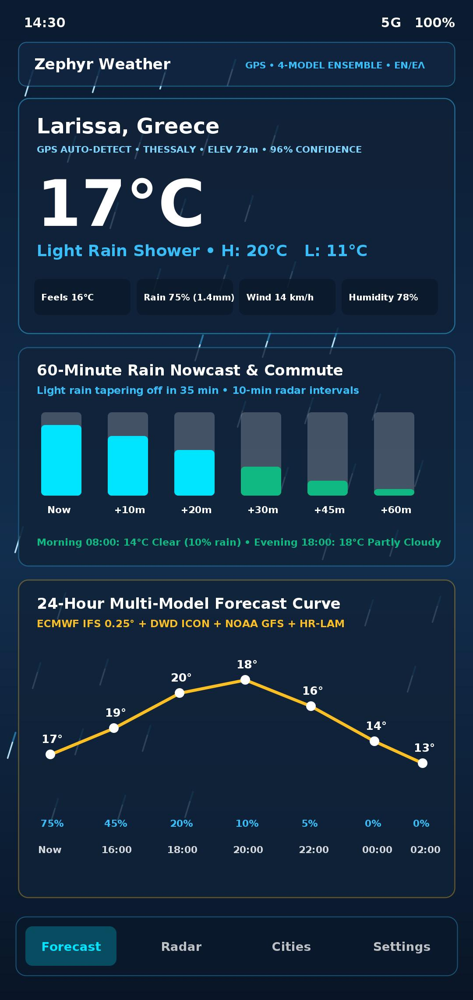
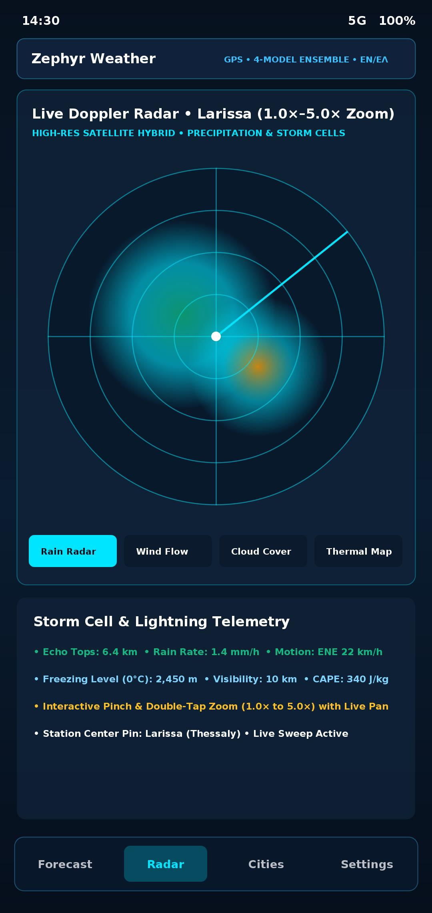
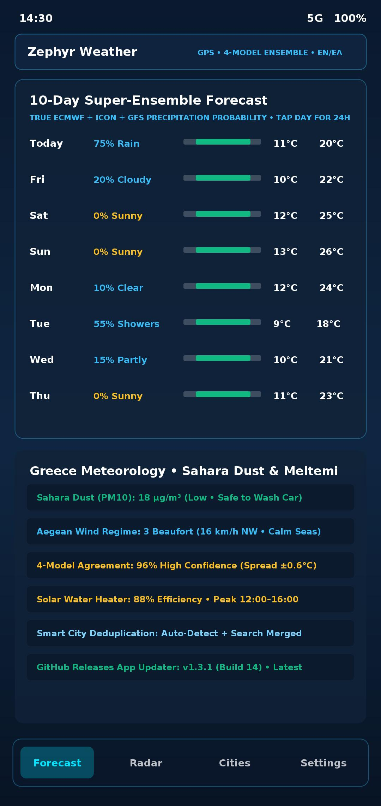

<div align="center">


# 🌤️ Zephyr Weather for Android (`v1.3.1`)
### **4-Model Super-Ensemble Forecasting • Instant GPS • Live Doppler Radar • 60fps Live Weather Sky • Bilingual (EN / ΕΛ)**

[-00E5FF?style=for-the-badge&logo=github&logoColor=white)](../../releases/latest)
[](../../releases)
[](../../stargazers)
[-22C55E?style=for-the-badge&logo=android&logoColor=white)](#-whats-new-in-v131--changelog-tap-here-to-download-zephyrweather131apk)
[](#-core-features)

---

# 📲 ⬇️ DOWNLOAD ANDROID APK HERE ⬇️

<table>
  <tr>
    <td align="center" width="600">
      <br/>
      <h2>🚀 <b>OFFICIAL ANDROID APK INSTALLER — <code>v1.3.1</code> (Build 14)</b></h2>
      <p><b>Tap either button below on your Android phone or tablet to download & install <code>ZephyrWeather.1.3.1.apk</code> immediately:</b></p>
      <p>
        <a href="../../releases/latest/download/ZephyrWeather.1.3.1.apk">
          
        </a>
      </p>
      <p>
        <a href="./ZephyrWeather.1.3.1.apk">
          
        </a>
      </p>
      <p>
        🔗 <a href="../../releases/latest"><b>Open GitHub Releases Page (v1.3.1)</b></a> &nbsp;•&nbsp;
        📥 <a href="./ZephyrWeather.1.3.1.apk"><b>Direct Repository File: <code>/ZephyrWeather.1.3.1.apk</code></b></a> &nbsp;•&nbsp;
        📂 <a href="./public/assets/ZephyrWeather.1.3.1.apk"><b>Assets APK: <code>/public/assets/ZephyrWeather.1.3.1.apk</code></b></a>
      </p>
      <br/>
    </td>
  </tr>
</table>

</div>

---

## 📸 App Screenshots Gallery

<div align="center">
  <table>
    <tr>
      <td align="center" width="33%">
        <a href="./public/assets/screenshot_1_forecast.jpg">
          
        </a>
        <br/>
        <b>🌤️ Live Forecast & 60-Min Nowcast</b>
        <br/>
        <sub>Live GPS forecast, 60-min rain nowcast bars & hourly curve</sub>
      </td>
      <td align="center" width="33%">
        <a href="./public/assets/screenshot_2_radar.jpg">
          
        </a>
        <br/>
        <b>📡 Live Doppler Radar</b>
        <br/>
        <sub>Interactive 1×–5× zoom radar sweep, rain echoes & wind vectors</sub>
      </td>
      <td align="center" width="33%">
        <a href="./public/assets/screenshot_3_widgets.jpg">
          
        </a>
        <br/>
        <b>🇬🇷 10-Day & Greece Meteorology</b>
        <br/>
        <sub>True 10-day rain %, Sahara Dust PM10, Meltemi & 4-model confidence</sub>
      </td>
    </tr>
  </table>
</div>

---

## 🚀 [What's New in `v1.3.1` — Changelog (Tap Here to Download `ZephyrWeather.1.3.1.apk`)](../../releases/latest/download/ZephyrWeather.1.3.1.apk)

<div align="center">
  <a href="../../releases/latest/download/ZephyrWeather.1.3.1.apk">
    
  </a>
</div>

### 🛠️ [Smart City Deduplication, True Rain Probability % & 60fps Live Rain Backdrop (Download APK ⬇)](../../releases/latest/download/ZephyrWeather.1.3.1.apk)
- **Smart City Deduplication (No Duplicate Cities)**: Searching for a city that was already found by GPS Auto-Detect (e.g., `Larisa` / `Larissa` / `Λάρισα` or `Athens` / `Αθήνα`) now automatically merges and selects the existing saved city instead of creating two duplicate entries.
- **Fixed 10-Day Rain Probability (`65%` Bug Fixed) & Real-Time Rain Detection**: Added full ECMWF IFS `0.25°` hourly and daily precipitation probability fusion, fixed freezing-level snow false positives on low-elevation cities, and ensured active rain shows immediately in the current condition and live background.
- **Ultra-Smooth 60fps Live Background Rain & Zero UI Lag**: Eliminated duplicate overlapping particle canvases and optimized volumetric cloud shaders so scrolling is 100% lag-free while live rain streaks, splash ripples, drifting clouds, snow crystals, and sunbeams animate smoothly in the background.

### 🌧️ [60-Min Hyper-Local Rain Nowcast, Sahara Dust Tracker & Weekend Planner (Download APK ⬇)](../../releases/latest/download/ZephyrWeather.1.3.1.apk)
- **60-Minute Hyper-Local Rain Nowcast & Commute Windows**: Live 10-minute precipitation bar graph (`+0m` to `+60m`) showing exact rain onset timing and intensity, paired with dedicated **Morning (`08:00`)** and **Evening (`18:00`)** commute weather slots.
- **4-Model Ensemble Confidence & Sahara Dust (`Αφρικανική Σκόνη`) Tracker**: Shows real-time agreement `%` across ECMWF, ICON, GFS, and HR-LAM, live PM10 Sahara Dust concentration (`μg/m³`) with car-wash advice, and barometric pressure bio-weather comfort.
- **Weekend Weather Planner & One-Tap Shareable Forecast**: Automatically highlights upcoming **Saturday & Sunday** weather side-by-side with an outdoor verdict badge and a one-tap **"Share"** button to share a formatted live forecast snapshot anywhere.

### 🔄 [Built-In GitHub Releases App Updater (Download `ZephyrWeather.1.3.1.apk` ⬇)](../../releases/latest/download/ZephyrWeather.1.3.1.apk)
- **One-Tap In-App Update Checker & Clickable Changelog**: Located at the bottom of the **Settings** tab — queries the GitHub Releases API (`/releases`), tracks real-time APK download counts across all releases (`125+`), and lets you download `ZephyrWeather.1.3.1.apk` in one tap.

---

## ✨ Core Features

| Feature | Description |
| :--- | :--- |
| 🛰️ **4-Model Super-Ensemble Engine** | Fuses **HR-LAM Best-Match (1–2 km)**, **ECMWF IFS 0.25° (9 km)**, **DWD ICON Seamless (2–7 km)**, and **NOAA GFS Seamless (13–25 km)** in parallel with outlier dampening, altitude lapse-rate calibration (`-6.5°C / 1000m`), and wet-bulb snow physics. |
| ⚡ **Instant Sub-100ms GPS & Smart City Deduplication** | Instant GPS coordinate resolution plus fuzzy search across all cities, islands, towns, and mountain villages in Greece and worldwide (supports English, Greek, and Greeklish) with automatic duplicate prevention. |
| 📡 **Live Doppler Radar & Satellite Map** | Interactive Web Mercator satellite map with real-time precipitation, wind stream particles, cloud cover, and temperature layers (`1.0×` – `5.0×` pinch/double-tap zoom). |
| 🏔️ **Mountain, Village & Snow Telemetry** | Displays live station elevation (`m`), `0°C` freezing level height, interactive altitude simulator (`0m – 2,500m`), snow depth, and snowfall accumulation alerts. |
| 🧭 **3D Meteorological Instruments & Widget** | Includes the **Helios 24h Sun/Moon Chrono-Dial**, **Voice Briefing & Flash-to-Bang Stopwatch**, **Solar Water Heater Advisor**, **Smart Comfort & Outfit Advisor**, and a **4×2 Home Screen AppWidget**. |
| 🇬🇷 **Bilingual English & Greek (`EN` / `ΕΛ`)** | Instant one-tap switching between English and Greek with localized Beaufort wind scales, EMY severe weather warnings, and metric/imperial units (`°C / °F`, `km/h / mph`, `hPa / inHg`). |

---

## 🛠️ Project Structure

```text
.
├── .github/workflows/build-apk.yml   # Automated APK Build & GitHub Releases Publisher (v1.3.1)
├── ZephyrWeather.1.3.1.apk           # Direct-download Android APK package (v1.3.1, Build 14)
├── public/assets/                    # Prebuilt ZephyrWeather.1.3.1.apk & real app UI screenshots
└── app/src/main/
    ├── AndroidManifest.xml
    ├── java/com/example/
    │   ├── MainActivity.kt           # Edge-to-edge Compose shell, 60fps sky backdrop & instant GPS fast-path
    │   ├── data/                     # Room Database, Preferences & 4-Model WeatherRepository
    │   ├── model/                    # Domain models, WMO mapper & bilingual localization
    │   ├── network/                  # Open-Meteo NWP, Air Quality, Nominatim & GitHub Releases APIs
    │   ├── ui/                       # WeatherViewModel, Forecast/Radar/Cities/Settings screens & v1.3.1 cards
    │   ├── util/                     # Doze-safe JobScheduler sync & SevereWeatherNotifier
    │   └── widget/                   # 4x2 Frosted-Glass Home Screen AppWidget
    └── res/                          # Custom adaptive launcher icon & Material 3 vector drawables
```
